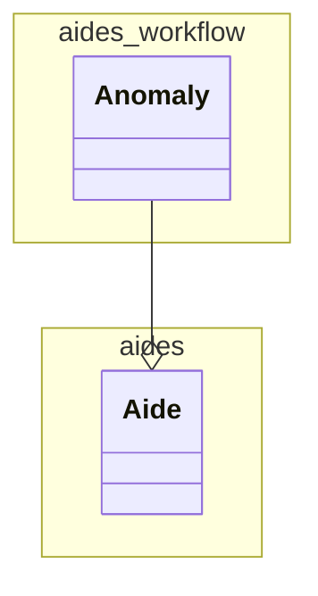

# aides_workflow

Ce module gère tout ce qui gravite autour des opérations humaines relatives à la gestion des aides dans Aides Agri :
* Détection d’anomalies dans la base de données ;
* Gestion humaine de ces anomalies dans l’interface d’administration du service ;
* Plus à venir.

## Modèle de données

## Flux de travail assurant la qualité des données

### Détection automatique de liens cassés

Les aides intégrées à Aides Agri contiennent des liens vers les sites officiels des pourvoyeurs d’aides, et vers les télédémarches.
Ces liens sont susceptibles d’être cassés au fil du temps par les dépublications côté pourvoyeurs, ou les changements de système d’information qui impliquent des changements d’adresses de contenus.

La commande `aides_workflow_scan_aides_for_anomalies` se charge de tester ces liens et déclarer des anomalies.

### Traitement humain des anomalies

Les anomalies sont listées dans l’interface d’administration. Les actions possibles pour l’opérateurice sont :
* Déclarer l’anomalie comme un faux positif (ce qui arrive souvent, car de nombreux sites de pourvoyeurs d’aides mettent en œuvre des protections anti-robots) ;
* Corriger le lien cassé dans l’aide (ce qui déclare l’anomalie comme traitée) ;
* Dépublier l’aide concernée (ce qui déclare l’anomalie comme traitée).
